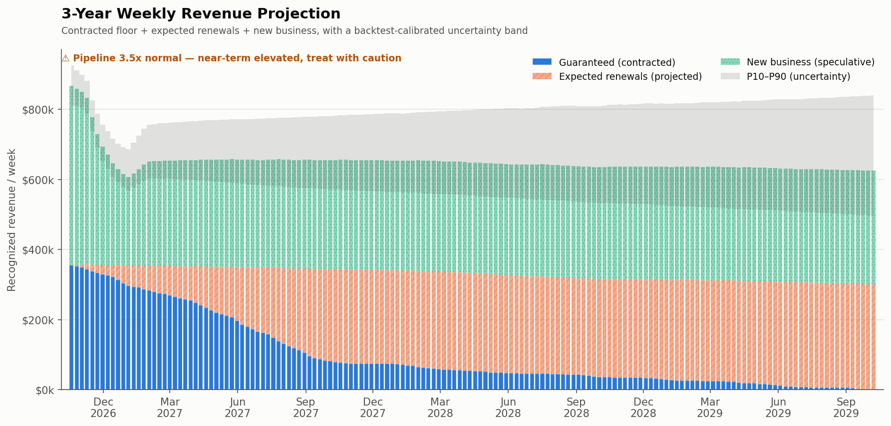
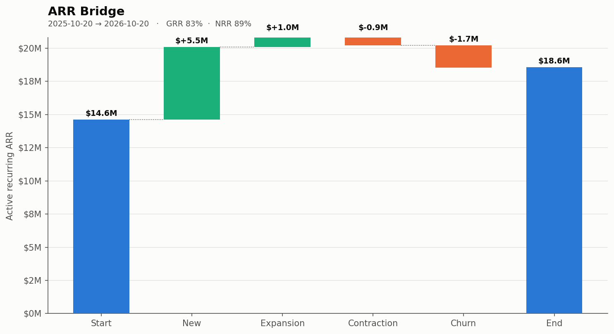
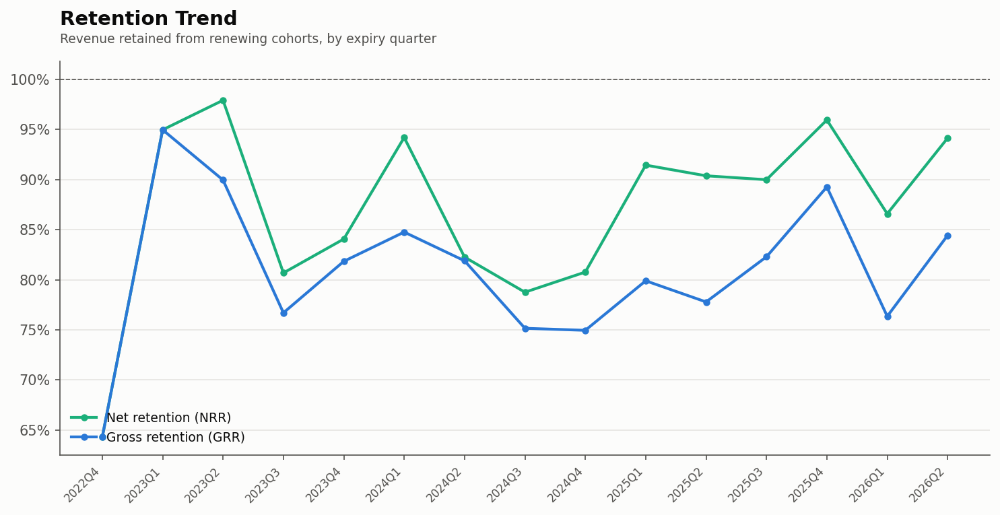
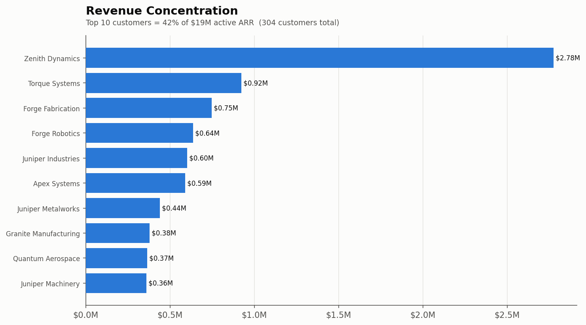
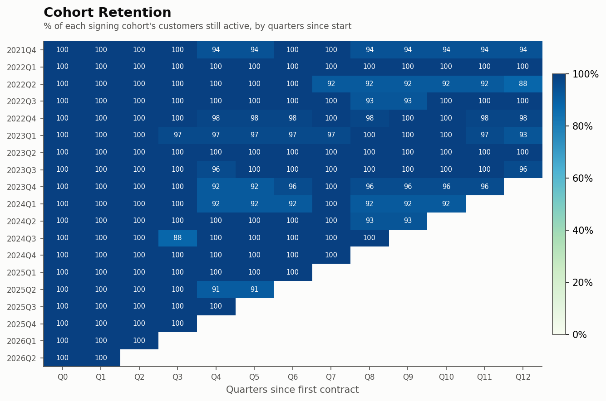

# Revenue Forecasting ETL

An end-to-end ETL pipeline that turns three messy sales sources into one governed
warehouse — and a **probabilistic, backtested revenue forecast** that's honest about how
much it actually knows.

Three product-billing systems and a CRM feed, each with its own schema, currencies, and
idea of who a "customer" is, are extracted, cleaned, entity-resolved into a Postgres star
schema, and turned into retention, concentration, and a three-layer revenue projection with
a Monte-Carlo uncertainty band.

- **Live walk-through & interactive dashboard:** [ryansportfolio.net]([https://ryansportfolio.net](https://ryansportfolio.net/login))
- **Methodology & design decisions:** [`docs/methodology.md`](docs/methodology.md) — every
  analytical choice (recognition basis, GRR vs NRR, censoring/maturation lag, pipeline
  calibration, backtesting) with the evidence behind it.



---

## What makes it non-trivial

The point of the project is the hard parts, not the plumbing:

- **Entity resolution** — one real customer (`Forge Fabrication`) appears across all three
  sources under four legal suffixes (LLC, Corp, GmbH, Ltd), two different ID schemes, and
  even a name-less row. Exact matches join directly; near-misses are fuzzy-matched; anything
  that can't be matched confidently is flagged `needs_review` rather than guessed.
- **Faithful extraction** — every source is read as raw text so the parser can't silently
  mangle it (Excel serial dates, `"04"` seat counts, and the region `"NA"` getting read as
  *null* are all handled deliberately in Transform, not guessed at in Extract).
- **Currency normalisation** — USD / GBP / EUR bookings converted to one reporting currency.
- **Revenue recognition** — recurring revenue is recognised ratably (ASC 606) over the
  contract term, not booked on the cash date.
- **Survival-modelled renewals** — a Kaplan–Meier survival curve with censoring for
  contracts too young to have resolved yet.
- **A calibrated pipeline model** — the CRM's stated win-probabilities are miscalibrated, so
  stage→win rates are re-learned from history and isotonically remapped; close timing comes
  from a stage-aware survival model.
- **A Monte-Carlo band** — the forecast ships a P10–P90 range (parameter uncertainty +
  stage correlation), never a single flattering number.
- **Point-in-time backtesting** — the pipeline is reconstructed as-of past dates from
  stage-change history (no look-ahead leakage) and scored with WAPE, pinball loss, and
  interval coverage.
- **Idempotent loads** — every write is an upsert, so re-running a batch never double-counts.

## Pipeline

```
L1  Extract    read each source as faithful raw text (3 product files + CRM opps & stage history)
L2  Transform  conform to one schema; type, clean, de-dupe, FX→USD, recognise revenue
L3  Unify      fuzzy entity resolution → company dimension; build the unified contract fact
 →  Load       idempotent upserts into a Postgres star schema
L4  Metrics    retention (GRR/NRR), ARR bridge, concentration, cohorts, the forecast + backtest
```

**Warehouse (star schema):** `dim_company`, `fact_contracts`, `map_customer`,
`fact_opportunity`, `pipeline_stage_history`.

## Selected outputs

| | |
|---|---|
|  |  |
|  |  |

(All charts regenerate into [`reports/`](reports/); the dashboard metrics are materialised to
JSON by `etl.metrics.emit`.)

## Tech

Python 3.12 · pandas / NumPy · SQLAlchemy + PostgreSQL 16 (Docker) · lifelines (survival) ·
matplotlib · 12-factor config via `DATABASE_URL`.

## Quickstart

Prerequisites: Docker and Python 3.12. Synthetic sample data ships in [`_data/`](_data/), so
the pipeline runs end-to-end out of the box.

```bash
# 1. config + database
cp .env.example .env                 # adjust if you like
docker compose up -d db              # Postgres on host port 5433

# 2. python env
python -m venv .venv && source .venv/bin/activate
pip install -r requirements.txt
export PYTHONPATH=src

# 3. Transform (L2) — writes clean CSVs to data/processed/
python -m etl.transform.product_a
python -m etl.transform.product_b
python -m etl.transform.product_c
python -m etl.transform.pipeline

# 4. Unify (L3) — entity resolution + the unified fact
python -m etl.unify.customer_match
python -m etl.unify.build_fact

# 5. Load — create the schema and upsert into Postgres
python -m etl.load.load_fact
python -m etl.load.load_pipeline
python -m etl.views.active          # recompute is_active / status as-of today

# 6. Metrics & outputs
python -m etl.metrics.chart         # projection.png + projection_series.json
python -m etl.metrics.dashboard     # the C-suite dashboard charts
python -m etl.metrics.emit          # materialise metric JSON for the web dashboard
```

## Operations

Two recurring jobs keep the warehouse fresh (not scheduled automatically — wire into cron on
deploy; see [`scripts/crontab.example`](scripts/crontab.example)):

| Job | Script | Cadence | What it does |
|-----|--------|---------|--------------|
| Fast loop | `scripts/ingest.sh` | every `n` min (`config/pipeline.yml`) | pull new API batches from the landing zone and upsert them |
| Nightly loop | `scripts/refresh_active.sh` | nightly | recompute `is_active` / `status` as-of today |

Both scripts are self-locating (they activate the venv and set `PYTHONPATH`), so cron can call
them by absolute path.

## Layout

```
src/etl/
├── extract/     # L1 — faithful raw readers (products + CRM pipeline)
├── transform/   # L2 — conform, type, clean, FX, revenue recognition
├── unify/       # L3 — entity resolution + unified fact build
├── load/        # schema + idempotent upserts into Postgres
├── views/       # as-of active/status refresh
└── metrics/     # retention, ARR bridge, concentration, cohorts, forecast, backtest, emit
config/          # non-secret operational config (pipeline.yml)
_data/           # synthetic source data (ships with the repo)
data/processed/  # pipeline output (git-ignored)
reports/         # generated charts
docs/            # methodology.md
scripts/         # cron entrypoints + SQL migrations
```

## A note on the data

The source data is synthetic. A hold-out "answer key" (the generators and ground-truth
labels) is kept out of the repo and was never read during the build — it exists only for a
final, honest validation of the model against the truth it was never shown.
